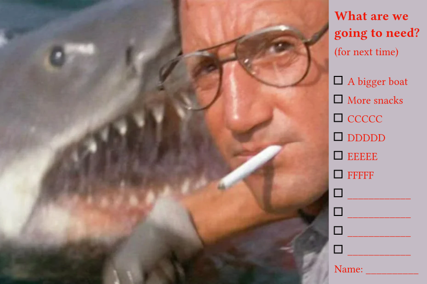
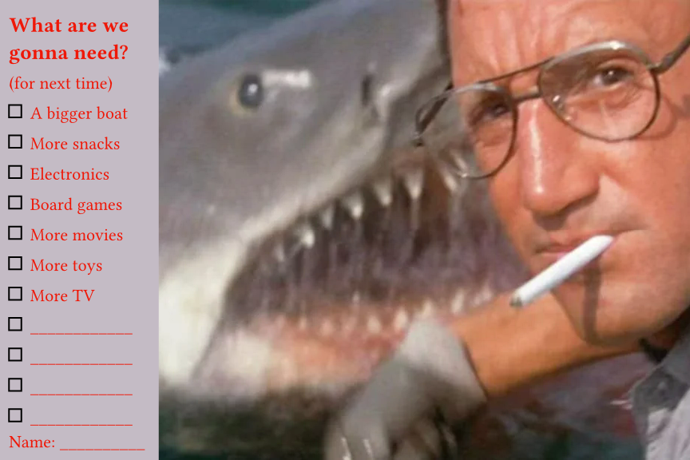

# Bigger Boat questionnaire

TODO: Add description ......

## Developer notes

.... `BiggerBoat.typ` is the main source file....

.... make in [Typst](https://github.com/typst/typst) .....

... `BiggerBoat.webp` is an screenshot from [Jaws](https://en.wikipedia.org/wiki/Jaws_(film)) ...

.... `BiggerBoat-1.png` and  `BiggerBoat-2.png` are exports from Typst .....
.... the `Makefile` can be used to build those two images .....

Files I probably won't keep:

* `test-print.pdf`
* `test-print.typ`
